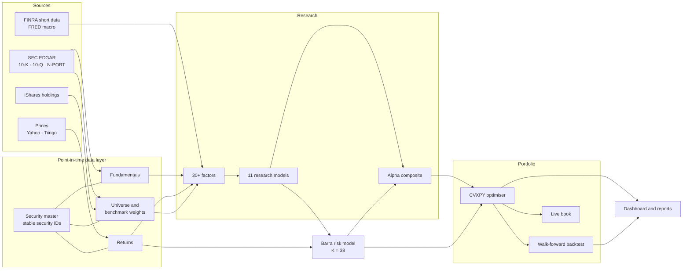
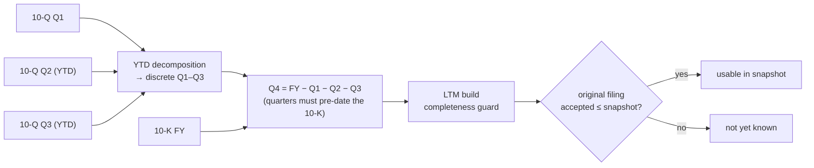
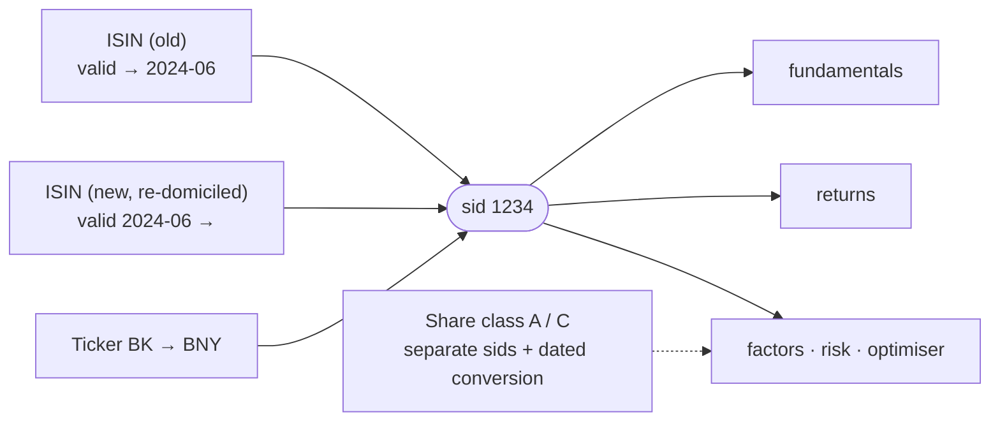
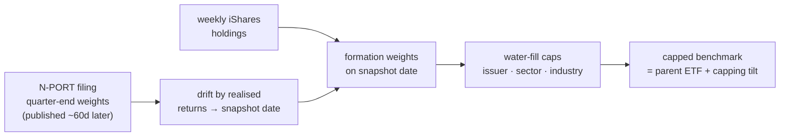
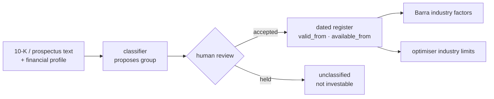
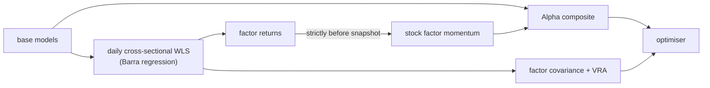

# Systematic Equity Investment Framework

&nbsp;&nbsp;&nbsp;

An end-to-end systematic equity process for US large caps (Russell 1000), built from scratch in Python. It starts with raw SEC filings and finishes with optimised, tradeable portfolios. Along the way it covers point-in-time fundamentals, a security master, 30+ factors aggregated into research models, a Barra-style risk model, a CVXPY optimiser, a walk-forward backtester and a Streamlit research dashboard.

The work lives in a private repository (~70k lines of Python, 640+ tests). This repo is a **showcase**: it gives the overview, sample output and a few representative modules. Those modules are reference code: they import the private data and identity layers, so they don't run on their own.

---

## Showcase

| | |
|---|---|
| **[Core Active — strategy backtest](https://thequantfather.github.io/quant-systematic-equity/reports/core_active_strict_backtest.html)** *(work in progress)* | The benchmark-relative strategy being taken live: about 50 names, a 3% tracking-error budget and ±2pp stock/sector/industry active bands against a capped Russell 1000 benchmark. Point-in-time walk-forward with monthly rebalances. *Placeholder: the linked page is an earlier run of the Strict variant; the official Core Active backtest is in progress.* |
| **[AI Industrials — thematic research](https://thequantfather.github.io/quant-systematic-equity/reports/ai_industrials_theme.html)** *(placeholder)* | An example of **AI-assisted research on top of the platform.** A Claude Code workflow queries the platform's point-in-time signals, risk exposures and fundamentals for a basket, then adds a sourced bull/bear narrative. More pieces to follow. |

---

## System at a glance

Each stage writes its own database and reads only from upstream ones. Factors, models and strategies are defined in config files, so adding one is a config change, not a code change.

---

## Engineering highlights

Most of the effort goes into getting the data *exactly as it was known on each historical date*. If that's wrong, a backtest looks better than it would have been in real time.

### 1. Point-in-time fundamentals from raw filings

**Problem.** 10-Qs report Q2 and Q3 year-to-date, there is no Q4 filing, and companies restate figures in later filings. Naive parsing double-counts quarters and quietly uses restated numbers that weren't known at the time.

**Approach.** Statements are parsed straight from XBRL. Year-to-date figures are split into discrete quarters *before* Q4 is derived as FY − Q1 − Q2 − Q3, and the order matters. Trailing-twelve-month (LTM) values need enough real quarters, otherwise they are left missing rather than being a partial sum. A figure only becomes usable once its original filing was accepted on or before the snapshot date; later restatements never overwrite history.

### 2. A security master: one identity per security

**Problem.** Over years of history, securities change ISIN (re-domiciles), ticker (rebrands), share structure (class conversions) and corporate form (mergers). Keyed on ISIN or ticker, fundamentals get stranded under an old identifier, return series break, and a backtest silently gives held names a 0% return.

**Approach.** Every analytical table is keyed on a stable internal security ID (`sid`). External identifiers carry effective dates, so an ISIN or ticker resolves to the right security *as of* a date. Corporate actions are explicit, dated, reviewed records, never heuristics. Writers validate identity on every write and fail loudly on an unknown security.

### 3. Point-in-time universe and benchmark weights

**Problem.** Index holdings from fund filings (N-PORT) are published about 60 days after quarter-end. Using them as-is means every historical benchmark is a stale picture. Some benchmarks (capped indexes) have no tradeable ETF at all.

**Approach.** As-filed weights are kept unchanged, then drifted forward to each snapshot date by each constituent's realised return and renormalised. Recent periods use archived weekly iShares holdings. Capped benchmarks are built with a deterministic water-fill (issuer, sector and industry caps). Their return series is the real parent ETF plus the capping tilt, which cancels the reconstruction bias. Replicating the S&P 500 from stored weights went from **2.4% to 1.1% tracking error**.

### 4. In-house industry classification

**Problem.** Vendor industry classifications are licensed, can be revised after the fact, and don't map cleanly onto how the risk model should group businesses.

**Approach.** A vendor-free taxonomy is fitted from each company's own filings (10-K business description, or prospectus for new listings) and financial profile. A model proposes a group, a human review accepts it, and the result goes into a dated register with the same validity and availability rules as every other attribute. Taxonomy versions are frozen, and history is never rewritten. The labels drive the risk model's 25 industry factors and the optimiser's industry limits.

### 5. Risk model and alpha built in a dependency-safe order

**Problem.** One alpha leg (stock-level factor momentum) is built from the risk model's own factor returns. Done naively, that is circular or leaks the snapshot day into the signal.

**Approach.** The risk model is estimated first. Factor momentum uses factor returns strictly before the snapshot date, and the final alpha composite is assembled only after that. Factor momentum is never itself a risk factor, which keeps the model non-circular.

**Other guards:**
- Market caps stay consistent through stock splits: point-in-time share counts are restated onto the price basis.
- A rebranded ticker is re-resolved, but only after the new symbol is shown to print live quotes.
- Unadjusted splits and mid-session price bars fail the price update.
- Banks and REITs get sector-native factors instead of generic ratios that don't apply to them.

---

## Signals, risk and portfolio construction

**Factors (30+)** are computed per stock per snapshot, cross-sectionally winsorised and z-scored, and stored unsigned. Direction is applied only when models are scored.

| Family | Examples |
|---|---|
| Quality / profitability | ROIC, margins, accruals, earnings stability, Altman Z, interest coverage |
| Value | earnings, FCF, sales and book yields, EV/EBITDA |
| Growth | 3–5-year OLS trend slopes, robust to depressed base years |
| Price-based | 12M/6M momentum, reversal, realised volatility, liquidity |
| Short interest | days to cover, short-volume ratio |
| Sector-native | banks: NIM, efficiency ratio, credit cost, tangible book; REITs: FFO measures |

**Models.** Factors are blended into 11 research models: Profitability, Balance Sheet Quality, Value, Growth, Momentum, Size, Low Volatility, Liquidity, Short Interest, Long- and Short-term Reversal. A name with thin factor coverage is shrunk towards neutral rather than scored on a partial slice. An **Alpha** composite combines the models plus stock-level factor momentum.

**Barra risk model.** **Σ = X F X′ + Δ**, with K = 38 factors: market, 25 in-house industry groups, beta, and the base models as style factors. It uses a daily constrained √mcap-WLS regression, two-half-life EWMA covariance with Newey–West, spectral flooring, and a volatility-regime adjustment on both F and Δ. See [docs/RISK_MODEL.md](docs/RISK_MODEL.md).

**Optimiser.** CVXPY, config-driven:
- **Objectives:** maximise alpha (benchmark-relative, with an optional risk-aversion term), maximum Sharpe (Charnes–Cooper) or minimum variance.
- **Constraints:** tracking-error and portfolio-volatility caps; stock, sector, industry and issuer limits; cardinality and minimum holding size (MOSEK mixed-integer); market-neutral long/short.

---

## Code tour

| File | What to look at |
|---|---|
| [`pipeline/create_barra.py`](pipeline/create_barra.py) | Factor risk model: constrained cross-sectional regression, EWMA/Newey–West covariance, VRA, stock factor momentum |
| [`pipeline/create_factors.py`](pipeline/create_factors.py) | Point-in-time factor construction: YTD → Q4 derivation, LTM guards, growth trend slopes, sector-native factors |
| [`pipeline/create_models.py`](pipeline/create_models.py) | Factor-to-model aggregation, coverage shrinkage, composite assembly |
| [`optimize_portfolio.py`](optimize_portfolio.py) | CVXPY formulations: stacked-factor risk, tracking-error and cardinality constraints, long/short |
| [`backtest.py`](backtest.py) | Point-in-time walk-forward engine: holding periods, corporate-action-aware returns |
| [`tests/test_factor_math.py`](tests/test_factor_math.py) | A sample of the test suite: Q4 derivation, YTD decomposition, z-score edge cases |

---

## Dashboard

A Streamlit dashboard sits on top of the databases:
- single-stock deep dives;
- an opportunities scanner;
- the backtester;
- the portfolio optimiser and risk explorer;
- data-quality monitoring;
- macro signals.

Every panel is built to answer one question about data health, research or portfolio state. *Screenshots to follow.*

---

*For educational and research purposes only. Not investment advice.*
